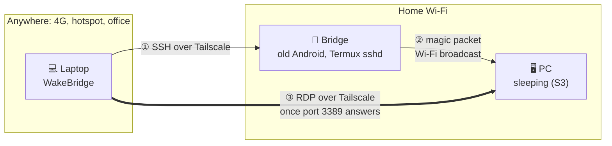

<p align="center">
  
</p>

<h1 align="center">WakeBridge</h1>

<p align="center">Wake your sleeping PC over Wi-Fi through an old phone on Tailscale, then jump straight into RDP.</p>

<p align="center">
  <a href="LICENSE"></a>
</p>

A small Windows tray app built with [Tauri 2](https://tauri.app). It lists the devices on your tailnet,
and when the PC you want is asleep, it asks a bridge device at home to wake it up.

> Independent project, not affiliated with Tailscale Inc. Tailscale is a trademark of Tailscale Inc.



## Why

Wake-on-LAN is a link-layer broadcast: it never leaves your home network, and Tailscale (which works
at the IP layer) can't carry it. A sleeping PC is also offline on Tailscale, so there is nobody to
talk to. WakeBridge solves this with a device that is always on at home (the *bridge*): you reach it
over Tailscale, and it shouts the magic packet on the local Wi-Fi.

## How it works

- **Devices, IPs and status** come from `tailscale status --json`. No hard-coded IPs.
- **Wake**: SSH into the bridge and pipe a short Python script through stdin. It sends the magic
  packet (6 × `FF` + the MAC 16 times) to `255.255.255.255` and to the local subnet broadcast. The
  app then polls port 3389 every 3 s and opens `mstsc` as soon as the PC answers.
- **Online vs. awake**: Tailscale takes minutes to mark a sleeping PC offline, so the app trusts
  port 3389 instead of Tailscale's online flag.
- **Config** is only what Tailscale can't know: which device is the bridge, and each PC's MAC.
  It lives in `%APPDATA%\com.gustacassel.wakebridge\config.json` and is edited from the UI.
- Closing the window hides it to the tray. Quit from the tray menu.

## Requirements

### Machine running the app
- Windows, Tailscale connected
- An SSH key authorized on the bridge (the app uses `BatchMode`, there is no way to type a password)

### Bridge (an old Android works great)
- Tailscale set as **Always-on VPN**
- [Termux](https://github.com/termux/termux-app/releases) and [Termux:Boot](https://github.com/termux/termux-boot/releases),
  both from the same source (GitHub or F-Droid), with `pkg install openssh python`
- `~/.termux/boot/start.sh` running `termux-wake-lock` and `sshd`
- No secure lock screen, so Termux:Boot runs after a reboot without anyone unlocking the phone
- Termux, Termux:Boot and Tailscale excluded from battery optimization

### PC to be woken
- Network adapter allowed to wake the computer, **magic packet only**
- Hibernation off (`powercfg /h off`): Wi-Fi can wake from sleep (S3), never from hibernate (S4) or shutdown (S5)
- BIOS: ErP disabled, Wake on LAN enabled
- Always **sleep** it, never shut down

> **Wi-Fi only?** Wake-on-WLAN works from sleep only, because the adapter must stay associated with
> the access point, and only the OS driver can do that. With a cable, classic WoL also works from shutdown.

## SSH key for the bridge

On the machine running the app:

```powershell
ssh-keygen -t ed25519
type $env:USERPROFILE\.ssh\id_ed25519.pub | ssh -p 8022 <bridge-ip> "cat >> ~/.ssh/authorized_keys"
```

Once `ssh -p 8022 <bridge-ip>` logs in without a password, turn password login off in Termux:
set `PasswordAuthentication no` in `$PREFIX/etc/ssh/sshd_config` and restart `sshd`.

## Development

Needs [Rust](https://rustup.rs), the Visual Studio Build Tools (C++ workload) and Node.js.

```powershell
npm install
npm run tauri dev     # run with hot reload
npm run tauri build   # installer in src-tauri\target\release\bundle\nsis
cd src-tauri; cargo test
```

## License

[MIT](LICENSE)
